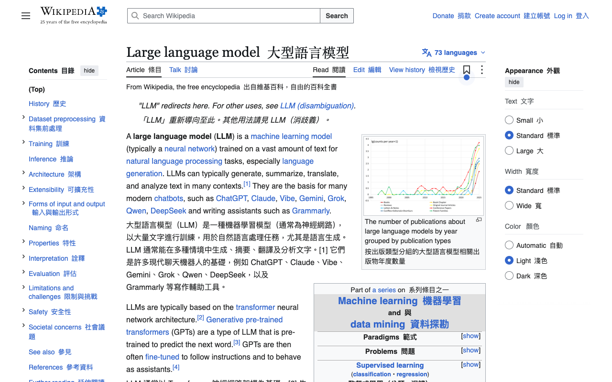
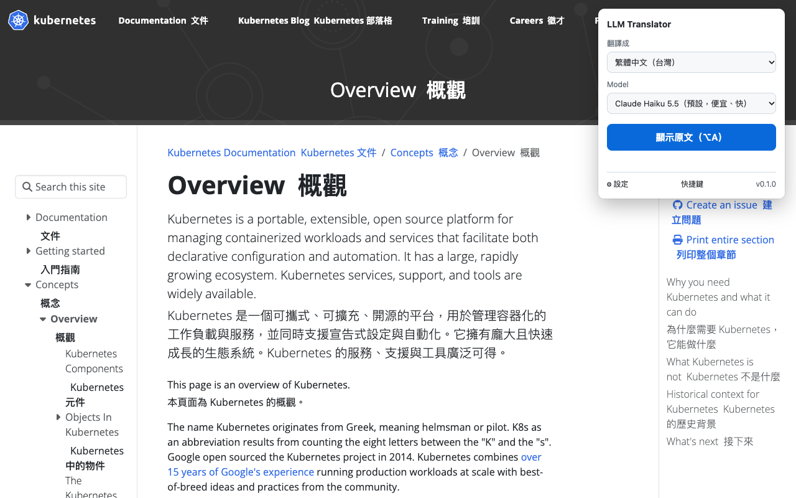
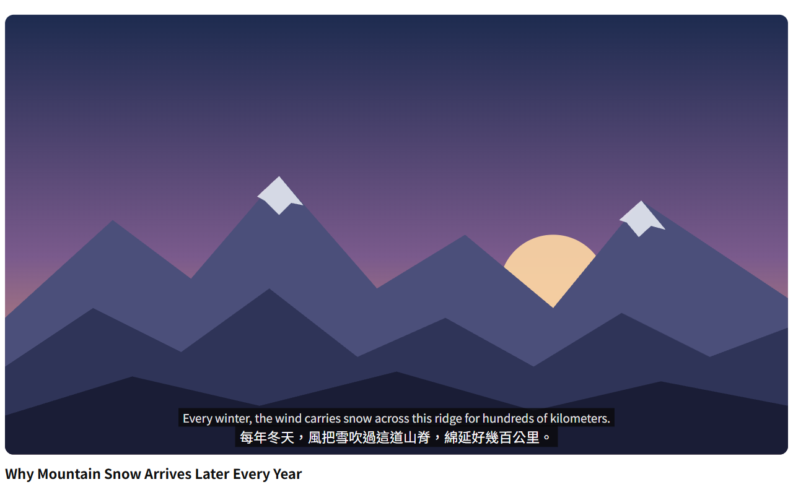

# Open LLM Translator

English | [繁體中文](README.zh-TW.md)

A Chrome extension that translates web pages with the large language model (LLM) of your choice and shows each translation right below the original paragraph, so you can read both side by side. It also adds bilingual subtitles to YouTube videos.

Bring your own API key for Anthropic (Claude), OpenAI (GPT) or Google (Gemini). There is no account, no subscription and no server in between: your browser talks to the provider directly.



## Features

- **Bilingual view**: translations appear under each paragraph and keep the page's own fonts, colors and links.
- **Translates what you see**: only paragraphs on screen are sent; more are translated as you scroll, which keeps token costs low.
- **Streams as it goes**: each paragraph shows up as soon as its translation arrives.
- **Works on dynamic pages**: content loaded later and single-page apps are picked up automatically.
- **Local cache**: the same text on the same site is never translated (or billed) twice.
- **YouTube bilingual subtitles**: original and translated captions together in the player, including full screen. Captions are merged into full sentences first, so auto-generated captions translate cleanly.
- **Target languages**: Traditional Chinese (Taiwan), Simplified Chinese, English, Japanese, Korean.

The interface is available in English, Japanese, Simplified Chinese and Traditional Chinese and follows your browser's language by default; any other language shows English. To pick one yourself, use **UI language** on the options page (Follow browser, English, 日本語, 简体中文 or 繁體中文); it applies at once. The shortcut descriptions on `chrome://extensions/shortcuts` and the Chrome Web Store description always follow the browser's language. A fresh install also starts with the target language matching your browser's language (English if it is not one of the five), and you can change it any time.

| Toolbar menu | YouTube subtitles |
|---|---|
|  |  |

## Install

**Chrome Web Store**: under review; the link will be added here once it is published.

**From a GitHub Release** (manual install):

1. Download `open-llm-translator-<version>.zip` from the [latest release](https://github.com/YihongGao/open-llm-translator/releases/latest) and unzip it.
2. Open `chrome://extensions` and turn on **Developer mode** (top right).
3. Click **Load unpacked** and select the unzipped folder.

Manual installs do not update automatically. Each release zip carries a [build provenance attestation](https://docs.github.com/actions/security-for-github-actions/using-artifact-attestations), so you can check it was built from this repository by its CI:

```bash
gh attestation verify open-llm-translator-<version>.zip --repo YihongGao/open-llm-translator
```

## Get started

1. Get an API key from one provider. You only need one:
   - Anthropic: [console.anthropic.com](https://console.anthropic.com/settings/keys)
   - OpenAI: [platform.openai.com](https://platform.openai.com/api-keys)
   - Google Gemini: [aistudio.google.com](https://aistudio.google.com/apikey)

   Worried about your key being stolen? Web pages, other extensions and the developer cannot read it, and it never leaves your computer except to go to the provider. See [How your API key is protected](docs/api-key-security.md) for what is and is not covered. As an extra safeguard, create a key just for this extension and set a spending limit with the provider ([Anthropic](https://console.anthropic.com/settings/limits), [OpenAI](https://platform.openai.com/settings/organization/limits), [Google](https://aistudio.google.com/spend)), so even a leaked key cannot cost much.
2. Right-click the extension icon and choose **Options**. Pick a model, paste the key for that provider, and click **Test connection**.
3. On any page, click the extension icon and press **Translate this page**, or press `Alt+A` (`Option+A` on macOS). Press it again to show only the original.
4. On a YouTube video, the menu also offers **Turn on bilingual subtitles**, shortcut `Alt+S` (`Option+S` on macOS). Subtitles and page translation are separate switches, so you can translate only the subtitles or only the comments. Subtitles stay on when you move to another video in the same tab; after a page reload, turn them on again.

The target language must differ from the page's own language: on an English page with English as the target nothing is translated, and a notice tells you to pick another language under **Translate to** in the toolbar menu. You can change the target language and model from the toolbar menu at any time; a translated page is re-translated right away. Shortcuts can be changed at `chrome://extensions/shortcuts`.

If something fails (for example, a missing or invalid key), a notice appears in the top-right corner of the page. Click the ⚠ next to a paragraph to see why that paragraph failed; turning translation off and on again retries it.

## Cost

You pay your provider directly at its API prices. Each provider offers three tiers (prices per million input / output tokens, November 2026):

| Tier | Anthropic | OpenAI | Gemini |
|---|---|---|---|
| Cheap and fast | `claude-haiku-5-5` (default) $0.10 / $0.50 | `gpt-6-luna` $0.10 / $0.50 | `gemini-3.5-flash-lite` $0.30 / $2.50 |
| Balanced | `claude-sonnet-5-5` $2 / $10 | `gpt-6.2-sol` $2 / $10 | `gemini-4-hydrogen` $1.50 / $7.50 |
| Flagship | `claude-opus-5-5` $4 / $20 | `gpt-6.2-astra` $8 / $40 | `gemini-4-carbon` $4 / $20 (from 2026-12-01; $2 / $10 before) |

For scale, translating a full technical documentation page (about 75 paragraphs) costs about $0.0013 with Claude Haiku, $0.0015 with GPT-6 Luna and $0.005 with Gemini Flash-Lite. The larger models cost $0.03 to $0.05 for the same page.

Reasoning ("thinking") is set to the lowest level each model allows, because those tokens are billed as output.

## Privacy

- Nothing is sent until you start a translation on a tab. Then only the paragraphs on screen, the page title and the page address (without query string) go to the provider you selected, with your key.
- There is no developer server. No analytics or telemetry.
- Your API key is stored only on your device (`chrome.storage.local`). It is not synced through Chrome Sync, and web pages and other extensions cannot read it. What this does and does not protect against: [How your API key is protected](docs/api-key-security.md).
- OpenAI and Gemini requests are sent with `store: false`.

Full details: [Privacy Policy](docs/privacy-policy.md).

## Known limitations

- Translations are plain text: links and bold text inside a paragraph are not carried into the translation.
- Buttons, code blocks, editable fields and content marked `translate="no"` are not translated.
- Content inside iframes and Shadow DOM is not translated.
- Hidden content (dropdown menus, accordions, scroll-in animations) is translated within about a second of becoming visible.
- The translation cache is never pruned. Removing the extension deletes it.
- Page text is treated as data, not instructions, but a page could still try to manipulate how its own text is translated. The effect stays limited to translations on that site.
- YouTube subtitles work only on `www.youtube.com/watch`. Shorts, embedded players, m.youtube.com, YouTube Music and live streams are not supported, and videos without captions get no subtitles. YouTube changes can break this feature until the extension is updated.

## Feedback and contributing

- Found a bug or want a feature? [Open an issue](https://github.com/YihongGao/open-llm-translator/issues/new/choose).
- Security problem? Please report it privately; see [SECURITY.md](SECURITY.md).
- Want to build it or send a pull request? See [CONTRIBUTING.md](CONTRIBUTING.md).

## License

[Apache License 2.0](LICENSE)

YouTube and Gemini are trademarks of Google LLC, Claude is a trademark of Anthropic PBC, and OpenAI and GPT are trademarks of OpenAI. This extension is not affiliated with or endorsed by these companies.
