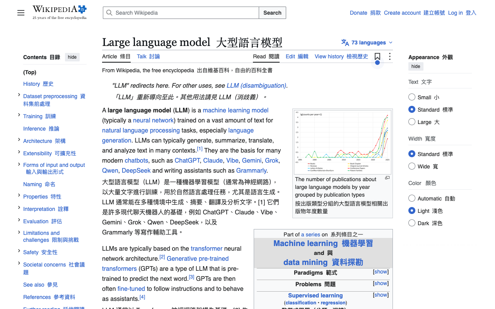
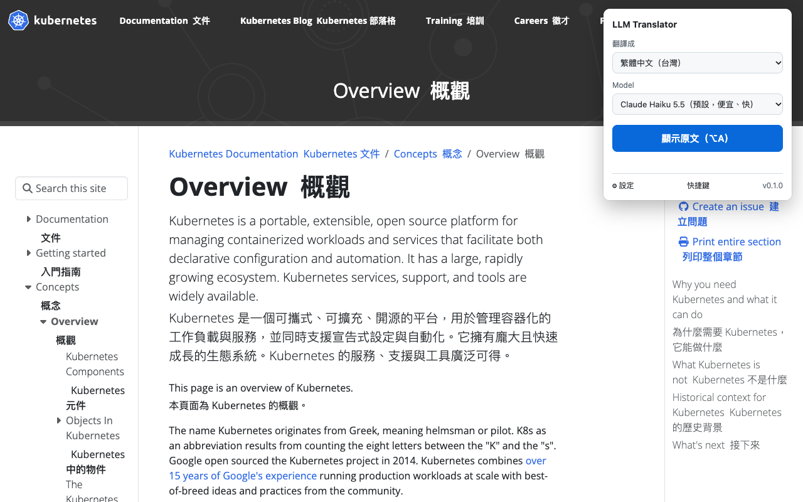
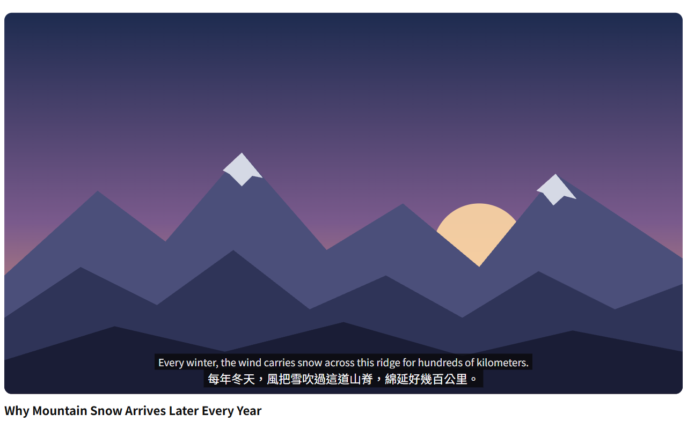

# Open LLM Translator

[English](README.md) | 繁體中文

用您選擇的大型語言模型（LLM）翻譯網頁，譯文直接顯示在每段原文下方，原文和譯文對照閱讀。也能為 YouTube 影片加上雙語字幕。

使用您自己的 Anthropic（Claude）、OpenAI（GPT）或 Google（Gemini）API key。不用註冊帳號、不用訂閱，中間也沒有任何伺服器：瀏覽器直接連到服務商。



## 功能

- **雙語對照**：譯文插在每段原文下方，沿用原頁面的字型、顏色與連結。
- **只翻看得到的段落**：只送出畫面上的段落，捲動時再翻下一批，省 token。
- **邊產生邊顯示**：每段譯文一收到就顯示，不用等整頁翻完。
- **支援動態內容**：之後才載入的內容與單頁應用（SPA）會自動補翻。
- **本機快取**：同一網站上的同一段文字不會重複翻譯，也不會重複計費。
- **YouTube 雙語字幕**：原文和譯文字幕一起顯示在播放器內，全螢幕也看得到。字幕會先合併成完整句子再翻，自動產生的字幕也能翻得通順。
- **圖片翻譯（Claude）**：在圖片上按右鍵（例如漫畫頁），選「翻譯這張圖片」；在會蓋住圖片、擋掉圖片選單的閱讀器上，改在頁面上按右鍵選「翻譯畫面上的圖片」。Claude 會讀出每個對話框裡的文字，把譯文直接畫在對話框上，也能一鍵切回原圖。會將圖片或其截圖傳送給 Anthropic。
- **目標語言**：繁體中文（台灣）、简体中文、English、日本語、한국어。

介面提供 English、日本語、简体中文、繁體中文，預設跟著瀏覽器的語言自動切換，其他語言一律顯示英文。想自己選的話，到設定頁的「介面語言」改選跟隨瀏覽器、English、日本語、简体中文或繁體中文，選了之後，設定頁和工具列選單立即生效；已在翻譯的分頁會在下次切換翻譯或出現錯誤時更新。chrome://extensions 和 Chrome 線上應用程式商店中的擴充功能說明，以及 chrome://extensions/shortcuts 的快捷鍵說明，一律跟隨瀏覽器的語言。剛安裝時的目標語言也會對應瀏覽器的語言（不在這五種之內就用 English），之後隨時可以更改。

| 工具列選單 | YouTube 雙語字幕 |
|---|---|
|  |  |

## 安裝

**Chrome Web Store**：[Open LLM Translator](https://chromewebstore.google.com/detail/open-llm-translator/kfpgaeciomngjohpbdpenmnknimkccgp)

**從 GitHub Release 手動安裝**：

1. 從[最新版本](https://github.com/YihongGao/open-llm-translator/releases/latest)下載 `open-llm-translator-<version>.zip` 並解壓縮。
2. 開啟 `chrome://extensions`，打開右上角的「開發人員模式」。
3. 點「載入未封裝項目」，選擇解壓縮後的資料夾。

手動安裝不會自動更新。每個 release 的 zip 都附有 [build provenance attestation](https://docs.github.com/actions/security-for-github-actions/using-artifact-attestations)，可以驗證它是由這個 repo 的 CI 建置的：

```bash
gh attestation verify open-llm-translator-<version>.zip --repo YihongGao/open-llm-translator
```

## 開始使用

1. 向任一家服務商申請 API key，只需要一家：
   - Anthropic：[console.anthropic.com](https://console.anthropic.com/settings/keys)
   - OpenAI：[platform.openai.com](https://platform.openai.com/api-keys)
   - Google Gemini：[aistudio.google.com](https://aistudio.google.com/apikey)

   擔心 key 被竊取嗎？網頁、其他擴充功能和開發者都讀不到它，它也只會從您的電腦送到服務商，不會送到其他地方。能防範什麼、不能防範什麼，見 [API key 如何受到保護](docs/api-key-security.zh-TW.md)。若想多一層保障，建議為這個擴充功能另建專用的 key，並在服務商那邊設定費用上限（[Anthropic](https://console.anthropic.com/settings/limits)、[OpenAI](https://platform.openai.com/settings/organization/limits)、[Google](https://aistudio.google.com/spend)），萬一 key 外洩，損失也有限。
2. 在擴充功能圖示上按右鍵，選「選項」。選擇 model，填入該家的 API key，按「測試連線」確認。
3. 在任何網頁點擴充功能圖示，按「翻譯此頁」，或按快捷鍵 `Alt+A`（macOS 為 `Option+A`）。再按一次就只顯示原文。
4. 要翻譯圖片，在圖片上按右鍵，選「翻譯這張圖片」。不論網頁翻譯選哪個 model，這個功能都需要 Anthropic 的 API key；圖片用的 model 在選項頁的「圖片翻譯 model」設定（預設 Claude Sonnet 5.5）。很多漫畫網站會在頁面上蓋一層看不見的元素並擋掉右鍵，圖片選單因此出不來；這時在頁面上按右鍵，選「翻譯畫面上的圖片」：畫面上可見部分兩邊都至少 160 px 的圖片都會翻譯（最多 4 張，大的優先）。頁面允許時會讀取圖片的原始解析度，比截圖更容易讀出小字。請先捲動到圖片大部分都在畫面上：圖片若有一部分在畫面外，只會翻譯可見的部分。圖片右上角的標籤可以切換原圖與譯文，按 ✕ 就移除譯文。
5. 在 YouTube 影片頁，選單會多一個「開啟雙語字幕」，快捷鍵 `Alt+S`（macOS 為 `Option+S`）。字幕和網頁翻譯是兩個獨立開關，可以只翻字幕或只翻留言。在同一分頁換到其他影片時，字幕會繼續作用；重新整理頁面後要再開一次。

目標語言要和網頁本身的語言不同：目標語言是 English 時，在英文網頁上不會翻譯任何內容，頁面會跳出提示，請到工具列選單的「翻譯成」改選其他語言。目標語言和 model 隨時可以在工具列選單切換，已翻譯的頁面會立即用新設定重翻。快捷鍵可以在 `chrome://extensions/shortcuts` 修改。

翻譯失敗時（例如 API key 沒設定或無效），頁面右上角會出現提示框。點段落旁的 ⚠ 可以看該段失敗的原因；關閉再開啟翻譯，就會重試失敗的段落。

## 費用

費用依各服務商的 API 價格，由您的帳號直接支付。每家各有三個檔位（價格為每百萬 token 的 input / output，2026 年 11 月）：

| 檔位 | Anthropic | OpenAI | Gemini |
|---|---|---|---|
| 便宜、快 | `claude-haiku-5-5`（預設）$0.10 / $0.50 | `gpt-6-luna` $0.10 / $0.50 | `gemini-3.5-flash-lite` $0.30 / $2.50 |
| 平衡 | `claude-sonnet-5-5` $2 / $10 | `gpt-6.2-sol` $2 / $10 | `gemini-4-hydrogen` $1.50 / $7.50 |
| 旗艦 | `claude-opus-5-5` $4 / $20 | `gpt-6.2-astra` $8 / $40 | `gemini-4-carbon` $4 / $20（2026-12-01 起；之前 $2 / $10） |

實際例子：翻譯一整頁技術文件（約 75 段），Claude Haiku 約 $0.0013、GPT-6 Luna 約 $0.0015、Gemini Flash-Lite 約 $0.005；較大的 model 同一頁約 $0.03 到 $0.05。

reasoning（thinking）都設在各 model 允許的最低檔，因為這些 token 以 output 計價。

翻譯一張圖片是一次請求，約 2,500 個 input token，加上回傳的文字；用 Claude Sonnet 5.5 每頁大約半美分到一美分（input token 是在漫畫頁上實測，output 沒有實測）。圖片的翻譯結果不會快取：同一張圖再翻一次會再計費。

## 隱私

- 在您對分頁按下翻譯之前，不會送出任何資料。按下之後，只有畫面上的段落、頁面標題與網址（不含查詢字串）會用您的 key 送到您選擇的服務商。
- 圖片翻譯只在您選「翻譯這張圖片」或「翻譯畫面上的圖片」時才送出資料：您看到的圖片會用您的 key 送到 Anthropic，形式是圖片本身（縮小並重新編碼為 JPEG，頁面允許時由頁面讀出），或是——頁面不允許、或圖片有一部分在畫面外時——圖片在畫面上那一塊的截圖（網頁蓋在圖片上的東西，例如固定在頂端的導覽列，也會在截圖裡）。都不會儲存。
- 沒有開發者伺服器，不蒐集分析或遙測資料。
- API key 只存在您的裝置上（`chrome.storage.local`），不經 Chrome Sync 同步，網頁和其他擴充功能都讀不到。能防範什麼、不能防範什麼，見 [API key 如何受到保護](docs/api-key-security.zh-TW.md)。
- 送到 OpenAI 和 Gemini 的請求都帶 `store: false`。

完整說明見[隱私權政策](docs/privacy-policy.md)。

## 已知限制

- 譯文是純文字：段落中的連結和粗體不會帶進譯文。
- 按鈕、程式碼區塊、可編輯欄位，以及標記 `translate="no"` 的內容不翻譯。
- iframe 和 Shadow DOM 裡的內容不翻譯。
- 圖片翻譯只支援 Claude，只處理頂層頁面的圖片（iframe 內的不行），而且只翻譯畫面上看得到的部分。文字框的位置由模型給出，可能略有偏差；音效字會被略過。結果不會快取。
- 隱藏的內容（下拉選單、手風琴、捲動時才出現的動畫）會在顯示後約一秒內翻譯。
- 翻譯快取不會自動清除。移除擴充功能時會一併刪除。
- 頁面文字會被當成資料而非指令處理，但網頁仍可能試圖影響自己文字的翻譯結果，影響範圍限於該網站的譯文。
- YouTube 字幕只支援 `www.youtube.com/watch`。Shorts、嵌入式播放器、m.youtube.com、YouTube Music 與直播都不支援；影片沒有字幕時不會產生字幕。YouTube 改版時，這個功能可能在擴充功能更新前失效。

## 問題回報與參與開發

- 發現 bug 或想要新功能？請[開 issue](https://github.com/YihongGao/open-llm-translator/issues/new/choose)，中文或英文都可以。
- 資安問題請私下回報，見 [SECURITY.md](SECURITY.md)。
- 想自己 build 或送 pull request？見 [CONTRIBUTING.md](CONTRIBUTING.md)。

## License

[Apache License 2.0](LICENSE)

YouTube 與 Gemini 是 Google LLC 的商標，Claude 是 Anthropic PBC 的商標，OpenAI 與 GPT 是 OpenAI 的商標。本擴充功能與這些公司無關，也未經它們認可。
